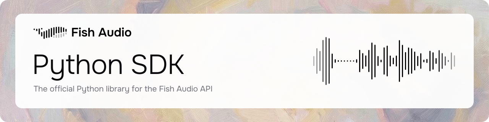

<picture>
  <source media="(prefers-color-scheme: dark)" srcset="https://raw.githubusercontent.com/fishaudio/fish-audio-python/refs/heads/main/.github/assets/banner-dark.svg" />
  
</picture>

# Fish Audio Python SDK

[](https://badge.fury.io/py/fish-audio-sdk)
[](https://pypi.org/project/fish-audio-sdk/)
[](https://pypi.org/project/fish-audio-sdk/)
[](https://codecov.io/gh/fishaudio/fish-audio-python)
[](https://github.com/fishaudio/fish-audio-python/blob/main/LICENSE)

The official Python library for the Fish Audio API

**Documentation:** [Python SDK Guide](https://docs.fish.audio/developer-guide/sdk-guide/python/) | [API Reference](https://docs.fish.audio/api-reference/sdk/python/)
> [!IMPORTANT]
> ## Changes to PyPI Versioning
>
> For existing users on Fish Audio Python SDK, please note that the starting version is now `1.0.0`. The last version before this was `2025.6.3`. You may need to adjust your version constraints accordingly.
>
> The original API in the `fish_audio_sdk` package has NOT been removed, but you will not receive any updates if you continue using the old versioning scheme.
>
> The simplest fix is to update your dependency to `fish-audio-sdk>=1.0.0` to continue receiving updates, or by pinning to a specific version like `fish-audio-sdk==1.0.0` when installing via your package manager. There are no changes to the API itself in this transition.
>
> If you're using the legacy `fish_audio_sdk` and would like to switch to the newer, more robust `fishaudio` package, see the [migration guide](https://docs.fish.audio/archive/python-sdk-legacy/migration-guide) to upgrade.

## Installation

```bash
pip install fish-audio-sdk

# With audio playback utilities
pip install fish-audio-sdk[utils]
```

## Authentication

Get your API key from [fish.audio/app/api-keys](https://fish.audio/app/api-keys/?utm_source=github&utm_medium=sdk-readme&utm_content=python):

```bash
export FISH_API_KEY=your_api_key_here
```

Or provide directly:

```python
from fishaudio import FishAudio

client = FishAudio(api_key="your_api_key")
```

## Quick Start

**Synchronous:**

```python
from fishaudio import FishAudio
from fishaudio.utils import play, save

client = FishAudio()

# Generate audio
audio = client.tts.convert(text="Hello, world!")

# Play or save
play(audio)
save(audio, "output.mp3")
```

**Asynchronous:**

```python
import asyncio
from fishaudio import AsyncFishAudio
from fishaudio.utils import play, save

async def main():
    client = AsyncFishAudio()
    audio = await client.tts.convert(text="Hello, world!")
    play(audio)
    save(audio, "output.mp3")

asyncio.run(main())
```

## Core Features

### Text-to-Speech

**Selecting a model:**

```python
# Recommended for production
production_audio = client.tts.convert(
    text="Production speech",
    model="s2.1-pro",
)

# Free to use, including on a new account with no API credit
free_audio = client.tts.convert(
    text="Free speech",
    model="s2.1-pro-free",
)

# Drama 3: our most expressive model (uses API credit)
drama_audio = client.tts.convert(
    text="Expressive speech",
    model="drama-3",
)
```

**With custom voice:**

```python
# Use a specific voice by ID
audio = client.tts.convert(
    text="Custom voice",
    reference_id="802e3bc2b27e49c2995d23ef70e6ac89"
)
```

**With speed control:**

```python
audio = client.tts.convert(
    text="Speaking faster!",
    speed=1.5  # 1.5x speed
)
```

**Reusable configuration:**

```python
from fishaudio.types import TTSConfig, Prosody

config = TTSConfig(
    prosody=Prosody(speed=1.2, volume=-5),
    reference_id="933563129e564b19a115bedd57b7406a",
    format="wav",
    latency="balanced"
)

# Reuse across generations
audio1 = client.tts.convert(text="First message", config=config)
audio2 = client.tts.convert(text="Second message", config=config)
```

**Chunk-by-chunk processing:**

```python
# Stream and process chunks as they arrive
for chunk in client.tts.stream(text="Long content..."):
    send_to_websocket(chunk)

# Or collect all chunks
audio = client.tts.stream(text="Hello!").collect()
```

**Word-level timestamps:**

```python
# Audio plus the start and end time of every word, for captions, highlighting or lip-sync
result = client.tts.convert_with_timestamps(text="Hello! Welcome to Fish Audio.")
save(result.audio, "output.mp3")

for segment in result.segments:
    print(f"{segment.start:.2f}s - {segment.end:.2f}s  {segment.text}")

# Or use audio and timings while they arrive
with client.tts.stream_with_timestamps(text="Long content...", format="opus") as stream:
    for event in stream:
        send_to_player(event.audio)
        update_captions(stream.segments)  # timings so far, in seconds from the start
```

Text without words (only punctuation, or a sound tag such as `[sigh]`) still produces audio, but the API has no timings for it: `segments` is then empty and `result.duration` is `None`.

[Learn more](https://docs.fish.audio/developer-guide/sdk-guide/python/text-to-speech)

### Speech-to-Text

```python
# transcribe-1-pro is the recommended model; without model, the request runs on transcribe-1.
with open("meeting.wav", "rb") as f:
    result = client.asr.transcribe(audio=f.read(), model="transcribe-1-pro")

# On transcribe-1-pro, text keeps <|speaker:N|> markers; speaker_turns has clean text per speaker.
print(result.text)

# Word-level timestamps
for segment in result.segments:
    print(f"[{segment.start:.2f}s - {segment.end:.2f}s] {segment.text}")

# Speaker turns (transcribe-1-pro, returned with timestamps)
for turn in result.speaker_turns or []:
    print(f"[{turn.start:.2f}s - {turn.end:.2f}s] {turn.speaker}: {turn.text}")

# Language of the transcript, when the API returns it
print(result.language_code)  # e.g. "en"
```

[Learn more](https://docs.fish.audio/developer-guide/sdk-guide/python/speech-to-text)

**Realtime (Preview):** stream live audio to `transcribe-stream-1` and get the transcript turn by turn. Send 16-bit mono PCM in 20–40 ms chunks as you capture it:

```python
import wave

def audio_chunks():
    with wave.open("speech.wav", "rb") as wav:  # 16-bit mono PCM, 16 kHz
        while chunk := wav.readframes(640):  # 40 ms
            yield chunk

# diarize=False gives plain text; by default it starts with a speaker tag: "<|speaker:0|> Hello."
for event in client.asr.stream_websocket(
    audio_chunks(), sample_rate=16000, drafts=True, diarize=False
):
    if event.type == "draft":  # live text of the open turn, not final
        print("...", event.text)
    elif event.type == "committed":  # final transcript of the turn
        print(event.text)
```

With `AsyncFishAudio`, pass an async iterator and use `async for`. The returned stream also sends control messages during the session, such as `stream.finalize()` for push-to-talk and `stream.agent_speaking(True)` for voice agents.

[Learn more](https://docs.fish.audio/features/speech-to-text/realtime)

### Real-time Streaming

Stream dynamically generated text for conversational AI and live applications:

**Synchronous:**

```python
def text_chunks():
    yield "Hello, "
    yield "this is "
    yield "streaming!"

audio_stream = client.tts.stream_websocket(text_chunks(), latency="balanced")
play(audio_stream)
```

**Asynchronous:**

```python
async def text_chunks():
    yield "Hello, "
    yield "this is "
    yield "streaming!"

audio_stream = await client.tts.stream_websocket(text_chunks(), latency="balanced")
play(audio_stream)
```

[Learn more](https://docs.fish.audio/developer-guide/sdk-guide/python/websocket)

### Voice Cloning

**Instant cloning:**

```python
from fishaudio.types import ReferenceAudio

# Clone voice on-the-fly
with open("reference.wav", "rb") as f:
    audio = client.tts.convert(
        text="Cloned voice speaking",
        references=[ReferenceAudio(
            audio=f.read(),
            text="Text spoken in reference"
        )]
    )
```

**Persistent voice models:**

```python
# Create voice model for reuse
with open("voice_sample.wav", "rb") as f:
    voice = client.voices.create(
        title="My Voice",
        voices=[f.read()],
        description="Custom voice clone"
    )

# Use the created model
audio = client.tts.convert(
    text="Using my saved voice",
    reference_id=voice.id
)
```

[Learn more](https://docs.fish.audio/developer-guide/sdk-guide/python/voice-cloning)

## Resource Clients

| Resource | Description | Key Methods |
|----------|-------------|-------------|
| `client.tts` | Text-to-speech | `convert()`, `stream()`, `convert_with_timestamps()`, `stream_with_timestamps()`, `stream_websocket()` |
| `client.asr` | Speech recognition | `transcribe()`, `stream_websocket()` |
| `client.voices` | Voice management | `list()`, `get()`, `create()`, `update()`, `delete()` |
| `client.account` | Account info | `get_credits()`, `get_package()` |

## Tracing

To continue your trace in the Fish Audio API, send a W3C `traceparent` header on each request. Use one of the ways below; if the OpenTelemetry instrumentation is enabled, it replaces a `traceparent` you set yourself.

**With OpenTelemetry**, enable [`opentelemetry-instrumentation-httpx`](https://pypi.org/project/opentelemetry-instrumentation-httpx/). HTTP calls and the WebSocket handshakes of `tts.stream_websocket()` and `asr.stream_websocket()` then carry the current trace: the same trace id, under a client span that the instrumentation creates. A WebSocket stream connects when you first iterate it, so iterate it inside your span.

```python
from opentelemetry.instrumentation.httpx import HTTPXClientInstrumentor

HTTPXClientInstrumentor().instrument()
```

**Without OpenTelemetry**, pass the header with each call:

```python
from fishaudio.core import RequestOptions, WebSocketOptions

headers = {"traceparent": traceparent}
audio = client.tts.convert(text="Hello!", request_options=RequestOptions(additional_headers=headers))
stream = client.tts.stream_websocket(text_chunks(), ws_options=WebSocketOptions(additional_headers=headers))
```

Or give the client an `httpx_client` with a request event hook, which runs for HTTP calls and WebSocket handshakes alike (with `AsyncFishAudio`, use an `httpx.AsyncClient` and an async hook):

```python
import httpx

def add_traceparent(request):
    request.headers["traceparent"] = current_traceparent()

client = FishAudio(httpx_client=httpx.Client(base_url="https://api.fish.audio", event_hooks={"request": [add_traceparent]}))
```

## Error Handling

```python
from fishaudio.exceptions import (
    AuthenticationError,
    RateLimitError,
    ValidationError,
    FishAudioError
)

try:
    audio = client.tts.convert(text="Hello!")
except AuthenticationError:
    print("Invalid API key")
except RateLimitError:
    print("Rate limit exceeded")
except ValidationError as e:
    print(f"Invalid request: {e}")
except FishAudioError as e:
    print(f"API error: {e}")
```

## Resources

- **Documentation:** [SDK Guide](https://docs.fish.audio/developer-guide/sdk-guide/python/) | [API Reference](https://docs.fish.audio/api-reference/sdk/python/)
- **Package:** [PyPI](https://pypi.org/project/fish-audio-sdk/) | [GitHub](https://github.com/fishaudio/fish-audio-python)
- **Legacy SDK:** [Documentation](https://docs.fish.audio/archive/python-sdk-legacy) | [Migration Guide](https://docs.fish.audio/archive/python-sdk-legacy/migration-guide)

## License

This project is licensed under the Apache-2.0 License - see the [LICENSE](LICENSE) file for details.
